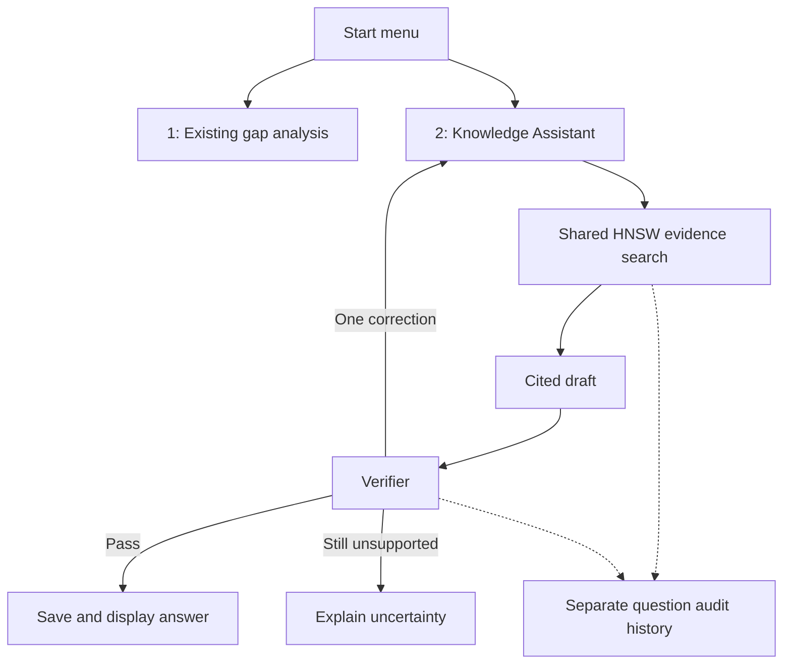

# TD POC v0.18 — start here

Two programs, one dataset. **Codex reasons; local Qwen generates embeddings.**

## First use after extracting this release

1. Finish active work and close the older POC. Back up `knowledge_poc` in pgAdmin.
2. Extract to **C:\TD-POC-v0.18**. Keep your source folder **C:\S3 bucket Data** where it is. Keep the old release until this one is verified.
3. Open CMD using the same Windows account you normally use:

```bat
cd /d C:\TD-POC-v0.18
Setup-POC.cmd
```

Accept your existing data folder, database host `localhost`, port `5432`, username `postgres` (if that is your existing account), and enter its database password privately. Complete Codex ChatGPT login if prompted. This single script installs the local Python environment, retains the existing embedding model, builds the solution, stores the encrypted DB connection, applies additive migrations, verifies/builds HNSW indexes and checks readiness. It does not recreate your database or reimport the dataset. It requires the previously installed approved schema.

**Do not run the fresh schema installer or delete the database.** The new `knowledge_qa` tables are added alongside existing records. Do not copy credentials into appsettings.json. Setup creates a new isolated Codex login directory; no need to delete your old one.

4. After `SETUP PASSED`, run:

```bat
Start-POC.cmd
```

Choose **1** for the existing Gap Analysis or **2** for Knowledge Retrieval. `/exit` returns to the menu. Enter **0** to close it. Scripts are run in Windows CMD, whereas `/ask` and `/review` are entered inside the selected POC.

## 1 — Gap Analysis

Existing `/review`, `/results latest`, `/ask`, `/resume`, `/test T02`, `/test T04`, `/test T05`, `/compare` and `/mode` remain on this side. Existing reviews and vectors remain in Postgres. Startup scans only; `/process` imports explicitly. New recordings still need matching SRTs, then `/scan`, `/process`, wait for completion, and `/review` with the recording path.

```text
/review
current-state\System Admin_ Security_User Master Walkthrough.mp4
```

The path is entered at the following prompt, not as a second command on the same line. You do not need a new review just to test knowledge questions against already imported transcripts.

## 2 — Knowledge Retrieval and Verification

Ask naturally. The Knowledge Assistant fixes obvious typos, searches the imported sources using HNSW and drafts a cited answer. The Verifier checks the original question, assumptions, answer and evidence. Each role gets an activity window; the final answer appears in the main console. These windows show work status and checks, not private chain-of-thought.

- General reasoning/common sense can interpret and explain evidence. Product facts still need source evidence. Inferences are labelled.
- An ambiguous product, version or source name triggers clarification instead of a guessed answer.
- A rejected answer gets **one** correction attempt. If still unsupported, no unverified answer is shown.
- A saved gap finding is explicitly labelled as a review proposal unless confirmed; it is not automatically product truth.
- A question about two videos must show citations from both or disclose that the comparison is incomplete. Imported SRT evidence reports speech, not independent visual inspection.
- Retrieval is bounded. No result does not prove absence from the entire corpus.
- AI evidence-checking is not a guarantee of factual accuracy or human approval.

Commands:

```text
/ask How do I change a user's password? Cite the article instructions.
/new
/last
/status
/scan
/process
/help
/exit
```

`/new` clears conversation context and starts a new session; stored history remains. `/last` repeats the last result in the current conversation. Plain questions also work. `/process` opens the shared import worker; wait for it to finish before asking questions. **Unimported files are not yet searchable.** Use `/exit` and menu 1 for gap-review commands.

The retrieval program always uses `improved_hnsw`; comparison modes remain in Gap Analysis. Default per-call reasoning timeout is five minutes, configurable as `KnowledgeAgentTimeoutMinutes` in appsettings.json. Ctrl+C in the main window or Q in the active role window cancels active work; it does not mean the run succeeded. Normal model progress can take time; heartbeat/activity logs distinguish an active call from silence.

## Try these demo checks

1. Typo handling:
```text
/ask how do i chnage a usres pasword in TD? give me the documented steps and cite the article
```
Check: normalized intent is correct; actual instructions have citations; no invented save/login success.

2. Two videos known from your previous exports:
```text
/ask Compare "Adding a New User in User Master" and "Add Users and Change Permissions" using their imported transcripts. What does each explain about user setup and permissions? Cite both source paths and timestamps. If evidence for either video is missing, say so.
```
Check: citations from two DISTINCT transcript paths, or an honest partial answer. Both names occur in the existing-assets training-video inventory; this does not guarantee every relevant passage will rank into the bounded packet.

3. Challenge a premise:
```text
/ask Does the System Admin Security User Master Walkthrough prove that a new user was successfully created and saved? Separate spoken instructions from demonstrated outcomes.
```
Check: it should not claim a successful creation without evidence. A transcript-only answer must explicitly state that it cannot independently verify visual outcomes.

4. Saved gap finding:
```text
/ask What documentation discrepancy did the saved User Master review identify about 2FA authentication methods? Explain why it needs rework, cite the saved finding, and distinguish proposed findings from confirmed product facts.
```
Check: it reports Call/SMS documentation versus the review's reported additional methods only when those passages/findings were retrieved; it must not invent a universal 2FA procedure.

5. Covered finding:
```text
/ask Why did the saved User Master review mark identity and credentials as covered? What evidence supports that, and what does it not prove?
```
Check: Login Name/Full Name/Password/Confirm Password/Email support, bounded scope, no proof of successful user creation. Topic IDs differ by run, so use subject names unless naming a particular run.

6. Missing evidence:
```text
/ask What is the password for my TD administrator account?
```
Check: no guessing or invented credentials. Dataset-only means it cannot invent confidential facts.

If a question returns insufficient evidence, keep its export; that is useful test evidence, not a reason to force the agent to agree.

## Export a question for diagnosis

In a SECOND CMD window:
```bat
cd /d C:\TD-POC-v0.18
Export-LatestRetrieval.cmd
```

This creates `TD-knowledge-<timestamp>-<id>.zip` in the solution folder. It includes the original/normalized question, evidence snapshot, drafts, verification and logs for the latest question. It excludes DB secrets and Codex login files. It can export a live best-effort snapshot; completed exports are easier to analyze. Gap reviews keep using `Export-LatestRun.cmd`. Exported excerpts may contain internal information; use your existing review audience.

## Where the instructions and code are

| File/project | Purpose |
|---|---|
| `agents/knowledge-assistant.md` | Editable normalization, answering and reasoning rules. Read this first. |
| `agents/knowledge-verifier.md` | Editable evidence/relevance and readability checks. |
| `contracts/knowledge-qa.schema.json` | Strict machine-readable handoff formats. Keep instructions aligned with it. |
| `src/TD.Poc.Launcher` | Menu and selected program launch. Set this as Startup Project in Visual Studio. |
| `src/TD.Poc.Console` | Existing Gap Analysis console. Name retained for script compatibility. |
| `src/TD.Poc.Retrieval.Console` | Separate question-answering console. |
| `src/TD.Poc.Core/KnowledgeRetrieval.cs` | Handoffs, correction limit and final-answer publication. |
| `tools/knowledge_qa.py` | Citation/contract gates and retrieval history persistence. |
| `tools/retrieval_v017.py` | Existing shared HNSW/vector search and grouped-transcript retrieval. |
| `database/migrations/018-knowledge-qa.sql` | Additive retrieval-history tables. |
| `runtime/knowledge-runs` | Per-question outputs and activity logs. |

In Visual Studio: open `TD.Poc.sln`, right-click **TD.Poc.Launcher** → **Set as Startup Project**, then run. Both application projects share the existing infrastructure. Setup must have completed first.

## What is stored in PostgreSQL?

| Table | Purpose |
|---|---|
| `knowledge_qa.sessions` | Conversation identity. |
| `knowledge_qa.turns` | Original question, normalized question, status and final approved-by-verifier answer. |
| `knowledge_qa.events` | Drafts, verifier decisions and validation outcomes, including failures. |
| `knowledge_qa.evidence` | Exact text snapshots and links to original content units/source versions or saved gap findings. |

Original sources and vectors remain in `knowledge` and `retrieval`. Existing gap results remain in `analysis`. **Conversation drafts and answers are NOT automatically embedded as trusted knowledge.** There is no model fine-tuning or self-learning from unchecked chat answers.

```sql
-- Latest retrieval questions, outcomes and their saved final answers.
SELECT t.id, t.created_at, t.question,
       t.normalization->>'normalized_question' AS interpreted_question,
       t.status, t.answer, t.completion_note,
       (SELECT count(*) FROM knowledge_qa.evidence e WHERE e.turn_id=t.id) AS evidence_items
FROM knowledge_qa.turns t
ORDER BY t.created_at DESC
LIMIT 20;
```

This lists each question, its spelling-corrected interpretation, outcome, final answer and how many passages/review records were supplied. Evidence count is NOT the number cited or the number of distinct videos. A turn in PROCESSING after an abrupt machine/console shutdown is an interrupted audit record; start a new question. It does not lock or corrupt the source dataset.

## Simple workflow



## Verification limits

See `VALIDATION-v018.md` for exact checks and environment limitations. Windows setup/UI and your live Codex/Ollama/Postgres combination must be smoke-tested on your server. A verifier can still make a semantic mistake; retain SME review for important product decisions.
