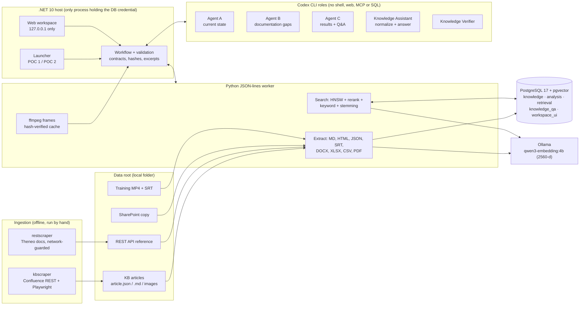
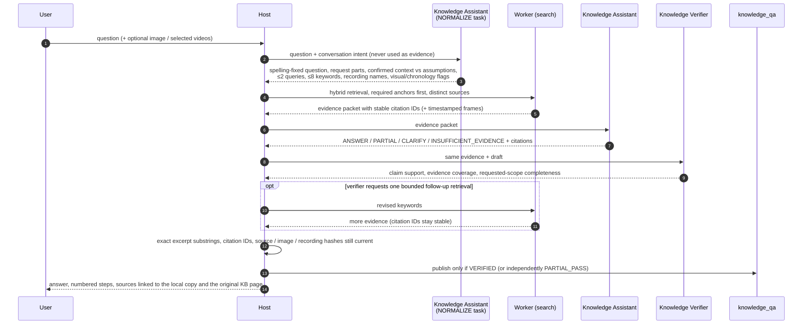

# Enterprise Knowledge Platform

> Evidence-checked product knowledge for a fintech support team: a verified ingestion stage, two local AI proofs of concept (documentation gap analysis and cited, independently verified Q&A over PostgreSQL/pgvector), and the design for turning them into an API-first enterprise platform.


> ⬅️ **Continues [knowledge-base-assistant](https://github.com/Ark310/knowledge-base-assistant)**, the June–July 2026 desktop
> RAG assistant. Its knowledge-base scraper was rebuilt here as the ingestion stage, and the retrieval moved to PostgreSQL/pgvector
> with an independent answer verifier.

**Read this first.** This repository holds two kinds of work, and they are kept apart on purpose:

| | Status |
|---|---|
| [**What the POCs do today**](#what-the-pocs-do-today) | **Built and verified.** A single-operator, loopback-only application on one Windows server. It ingests an offline copy of the KB site, the REST API docs, SharePoint files and training videos, and answers questions with verified citations or reports documentation gaps. |
| [**The enterprise platform design**](#the-enterprise-platform-design-not-yet-built) | **Designed, not built.** Support-portal integration, SSO, tenant separation, client- and staff-facing audiences, in-app diagnostics and ReadMe.io publishing. Documented in an engineering narrative and a production schema (revision 8) that two independent AI reviews assessed. Production work was parked on 3 Nov 2026. |

Nothing here is connected to a live support portal, and no client uses it.

---

## Overview

The product is **TradeDesk**, a back-office FX and payments system. What the support team knows about it
is scattered: a Confluence help site (46 spaces, 1,743 articles), Theneo-hosted REST API docs (835 pages),
SharePoint folders, about 33 recorded training sessions, years of support tickets, and people's heads.
Some of that knowledge is stale, and some of it is only true for one release or one client's
configuration. A generic answer can be confidently wrong.

The earlier [knowledge-base-assistant](https://github.com/Ark310/knowledge-base-assistant) proved that
retrieval over a scraped library helps. This project asks a stricter question: **can every answer be
proven from the sources, and can the system say exactly what it could not prove?** It has three parts:

1. **Ingestion** ([`ingestion/kb-site-scraper`](ingestion/kb-site-scraper)): two scrapers that make a
   complete, *verified* offline copy of the KB site and the API docs. Each article records how many
   dropdowns, code blocks, tables and images the page source had and how many were captured.
2. **POC 1, Documentation Gap Analysis**: walks a whole training recording (transcript plus sampled
   frames), lists every topic it actually demonstrates, then searches the documentation topic by topic
   and reports what is covered, what needs rework and what was not found.
3. **POC 2, Knowledge Retrieval and Verification**: answers questions with citations. A second,
   independent agent checks every claim, then the host checks every excerpt byte for byte before
   anything is shown or saved.

## What the POCs do today

### Features

- **Verified ingestion.** Confluence spaces and pages are listed through the REST API instead of by
  crawling navigation. Downloads are atomic and checked against Content-Length. Runs are journalled, so
  a crash can resume. Playwright takes full-page screenshots with every dropdown opened. The final audit
  of the KB site: 1,743 articles on disk out of 1,743 live, 0 missing, 0 stale.
- **A scraper that cannot call the API it documents.** The API docs embed a live "Try it" console for a
  financial API. A network guard only allows GET requests to the docs host and its static assets, blocks
  every API host, and never clicks Run. Any violation is flagged as a `SAFETY:` issue.
- **Provenance-first storage.** Every file is SHA-256 hashed, with an append-only identity and
  revisions, and is processed in one transaction. The file is hashed again after extraction, and a
  change rolls the transaction back. Formats that cannot be read yet (images, SNAG files, legacy DOC) are
  listed as `NEEDS_CONVERSION` and never claimed as searchable.
- **Timestamped video evidence.** SRT cues are grouped into passages of about 30 seconds (60 at most),
  with the original cues kept for citation. Frames come from a reusable, hash-verified cache.
  Zero-duration cues are kept as `POINT_ONLY` with a warning, never stretched.
- **Hybrid retrieval** (see [Retrieval](#retrieval)): halfvec HNSW candidates, a full-precision
  rerank, keyword matching and a PostgreSQL English-stemming lane, scoped by product family.
- **Assistant → Verifier → host validation** (see [the flow](#poc-2-assistant--verifier-flow)): outcomes
  are `ANSWER`, `PARTIAL`, `CLARIFY` or `INSUFFICIENT_EVIDENCE`. A verified partial answer lists what is
  confirmed, the documented steps, what is still unresolved, and the next question to ask.
- **Whole-recording gap reviews** (POC 1). A recording is reviewed in two-minute sections. Each topic gets
  one coverage row: `COVERED`, `NEEDS_REWORK`, `NOT_FOUND_IN_REVIEWED_SOURCES` or `NEEDS_REVIEW`. A gap
  means "not found in the sources reviewed", never "missing everywhere". Every finding stays
  `AGENT_PROPOSED` until a human approves it.
- **Local web workspace** (v0.24+, ASP.NET Core with a static front end). Per-chat history is stored in
  PostgreSQL. Source previews are pinned to the cited revision. Uploaded images stay private to the chat.
  A video library shows each recording's readiness; you can select up to two recordings per chat, see
  frame galleries and jump the video to a timestamp. Stop and progress controls are included.
- **Resilient imports** (v0.26–v0.027). Every stage, file, SQL statement and embedding call has a
  deadline. A heartbeat tracks progress. Timeouts are recovered only from a checkpoint whose attempt ID
  matches, and a status file that cannot be written no longer stops ingestion.

### Architecture



The C# host runs the workflow. It starts each Codex role as a separate process with its own isolated
`CODEX_HOME`, no ambient configuration, no MCP servers, and shell, web and app tools turned off. Each
prompt is in `agents/*.md`, and each output must validate against a JSON schema in `contracts/`. The
Python worker does extraction, persistence, embeddings and search, and talks to the host over a UTF-8
JSON-lines protocol. Agents never see SQL or credentials.

### POC 2: Assistant → Verifier flow



A database CHECK constraint makes it impossible to save a `VERIFIED` turn without both an answer and a
passing verification. A `VISUAL` claim needs an actual frame. If a required transcript changes after it
was cited, the answer is blocked as stale. Saved answers are an audit trail and are never fed back into
the corpus as evidence.

### Retrieval

| Stage | What it does |
|---|---|
| Embeddings | Local Ollama `qwen3-embedding:4b`. The stored dimension (2560) is checked rather than assumed. Immutable embedding-profile digests stop vectors from different models being mixed. |
| ANN candidates | Partial HNSW expression indexes on `embedding::halfvec(2560)` (halfvec keeps it under pgvector's 2,000-dimension limit for `vector`), with a candidate budget of 100 |
| Rerank | Candidates are re-scored with the original full-precision vectors |
| Keyword lane | Focused keyword matching, so generic words such as "settings" or "permission" don't dominate |
| Stemming lane | PostgreSQL `to_tsvector('english', …)` on titles and topics, so "posting" also matches "posted" |
| Identity first | A named recording resolves to its companion transcript before generic search. Exact phrases get required passages. |
| Assembly | Required anchors come before optional context. One passage per distinct source, duplicate bodies collapsed. Short sources are read whole (up to 24 units), long ones in sections chosen for the question. |
| Measured | `/compare` runs `old_exact`, `improved_exact` and `improved_hnsw` on the same query embedding and database snapshot, and records the real query plans to prove the HNSW index is used |

### Security controls (as built)

- **Web:** binds to `127.0.0.1` only. Host-header and Origin checks; cross-site `Sec-Fetch-Site`
  requests rejected. A random per-process token is required on every non-GET request. Strict CSP
  including `frame-ancestors 'none'`, plus nosniff, no-referrer, and no-store on the API.
- **Files:** no endpoint serves arbitrary files. Assets use opaque per-chat IDs and canonical path
  containment, and symlinks, junctions and reparse points are refused. Source HTML/SVG is never rendered
  inline, and only HTTP(S) links are allowed.
- **Uploads:** PNG, JPEG or WebP only, at most 10 MB and 4 per turn. Signature and dimension checks, then
  re-encoding with Pillow.
- **Prompt injection:** source text, questions and memory are all treated as untrusted data
  (`agents/shared-guardrails.md`). Agents cannot browse, execute code, publish or reach credentials.
- **Credentials:** the database connection string is encrypted with Windows DPAPI for the current
  account, and only the host decrypts it. The Codex login lives in its own `CODEX_HOME`, which `icacls`
  restricts to the current user. Release packages exclude credentials, logs and media.
- **Integrity:** SHA-256 on sources, frames and images. CHECK constraints on publication states. A
  single-writer engine lock with expiry.

### Verification ledgers

Every release from v0.16 on ships with a verification folder under `docs/verification-v0xx/`, and
v0.17 to v0.26 also have a `VALIDATION-*.md`. Failures were reproduced as failing tests first (the
`*-red*.txt` files) before they were fixed. **v0.027:**

| Check | Result |
|---|---|
| Python unit tests (`python -m unittest discover -s tests`) | 162 passed |
| Runtime host checks (C#) | 33 passed |
| Knowledge host checks (C#) | 41 passed |
| PostgreSQL 17 / pgvector integration checks | 8 passed |
| .NET Release build | 0 warnings, 0 errors |

Real failed runs were captured and replayed as regression fixtures, alongside synthetic fixtures where a
name has been changed, so that no answer or path is hardcoded. Fixed natural-language question sets
(`POC2-v023-Natural-Test-Questions.txt`, `Video-Test-Questions-v0.027.txt`) and an independent ChatGPT
comparison prompt support operator acceptance testing. Expected results for reviewers are kept out of the
agents' reach in `tests/reviewer-only`.

**What these numbers do not show.** The ledgers prove wiring, validation, recovery and retrieval
mechanics. They do **not** measure live answer accuracy. There are no recall, precision, acceptance-rate
or latency figures for real questions. The release notes say so explicitly ("not live-model answer
accuracy"), and sampled frames do not prove what happened between samples.

### Tech Stack

| Layer | Technology |
|---|---|
| Host, launchers, web workspace | C# / .NET 10 (console apps, ASP.NET Core minimal API), vanilla HTML/CSS/JS |
| Worker | Python 3.11+: psycopg 3, Pillow, pypdf, openpyxl, xlrd, jsonschema |
| Database | PostgreSQL 17 + pgvector 0.8 (halfvec HNSW). Approved v0.3.0 schema with 29 tables and 55 FKs, plus additive migrations 010, 017, 018, 020, 023 and 024 |
| Models | Codex CLI with a ChatGPT login for reasoning roles; Ollama `qwen3-embedding:4b` for embeddings |
| Media | ffmpeg (detects `-fps_mode` vs the legacy `-vsync` option) |
| Ingestion | Python, Playwright (Chrome, falling back to Edge), httpx (async), BeautifulSoup4 + lxml, PySide6 |
| Platform | Windows Server 2019, a single machine with an 8 GB consumer GPU |

### Getting Started

**Prerequisites:** Windows, .NET 10 SDK, Python 3.11+, PostgreSQL 17 with pgvector, Ollama, Codex CLI,
and ffmpeg (optional, for video).

```bat
git clone https://github.com/Ark310/enterprise-knowledge-platform.git
cd enterprise-knowledge-platform

:: 1. Install the approved schema once into an empty knowledge_poc database
::    (database/install-v0.3.0: 00-preflight, 01-install, 02-verify, 03-smoke-test)
:: 2. One-time setup: venv, build, DB connection (DPAPI), migrations, HNSW indexes, model, isolated Codex login
Setup-POC.cmd
:: 3. Start the launcher (1 = Gap Analysis, 2 = Knowledge Retrieval web workspace)
Start-POC.cmd
```

Put your own content under a data root with `current-state\` and `existing-assets\` folders, then choose
**Scan** and **Process** in the workspace. [`START-HERE.md`](START-HERE.md) is the full operator guide.

**Ingestion stage:**

```bat
cd ingestion\kb-site-scraper
python -m venv .venv && .venv\Scripts\pip install -r requirements.txt && .venv\Scripts\playwright install chromium
"Run KB Scraper.bat"        &:: or: python -m kbscraper
"Run REST API Scraper.bat"  &:: or: python -m restscraper
```

**Tests:**

```bat
python -m unittest discover -s tests                                   &:: POC worker, 162 tests
dotnet run --project tests\TD.Poc.HostTests -c Release                 &:: host checks
cd ingestion\kb-site-scraper && python -m pytest -q                    &:: scraper
```

The integration tests (`tests/integration_*.py`) need a disposable PostgreSQL with pgvector.

### Configuration

`config/appsettings.json` holds placeholders only: `DataRoot`, `EmbeddingModel`, `OllamaUrl`,
`CodexExecutable`, the search mode and candidate budget, agent timeouts and import deadlines. The
database connection is never written in plain text. `Configure-Database.cmd` prompts for it and saves it
encrypted with DPAPI to `config\database.dpapi`, which is git-ignored. The KB and API docs hosts are in
`ingestion/kb-site-scraper/*/settings.py`, shown here as `*.contoso.example`.

## The enterprise platform design (not yet built)

Alongside the POCs, an engineering narrative (v1, 9 Nov 2026) and a review package (blueprint v3,
decision register, requirements, agent catalogue) recast the work as an **API-first Enterprise
Knowledge Intelligence Platform**, with three domains: Knowledge Engineering, Intelligence Services and
Knowledge Applications. A 59-table production schema (revision 8) was reviewed independently by Claude
and by Gemini. The sanitized summaries are in [`docs/platform-design/`](docs/platform-design):

| Topic | Design | Built today? |
|---|---|---|
| Audiences | Staff, support analysts, authorised clients, the application itself (in-app diagnostics), the documentation team | Staff only (a single operator) |
| Support portal | Ticket-created webhook or polling → idempotent investigation job → ranked resolutions with citations for a human analyst; closed tickets become *candidate* evidence | No |
| Identity / SSO | Identity provider, tenant model, permission inheritance and row-level security are **open questions** | No (loopback, no accounts) |
| Tenant separation | Client-specific information stays private. Recurring issues can become general knowledge without exposing any client. Tenant-safe composite keys and redaction before any external call are production blockers. | No |
| Publishing | ReadMe.io as the single destination (if its audience separation is verified), with six document types, a media manifest, and human approval before anything is published | No (decided target only) |
| API | `POST /v1/search`, `/v1/conversations`, `/v1/cases/analyze`, `/v1/diagnostics/analyze`, `/v1/documentation/drafts`, `GET /v1/jobs/{id}` | No |
| Orchestration | A deterministic .NET workflow controller; Microsoft Agent Framework only if a short proof of concept shows a real benefit | Partly: the host orchestrates the POC roles |

Start with [docs/platform-design/README.md](docs/platform-design/README.md), then
[portal integration and identity](docs/platform-design/portal-integration-and-identity.md),
[API surface](docs/platform-design/api-surface.md) and
[schema reviews](docs/platform-design/schema-reviews.md).

## Project Journey / Version History

| Date (2026) | Version | What changed |
|---|---|---|
| Oct 19–21 | KB site scraper + REST API scraper | Rebuilt from the earlier assistant's scraper as a dedicated, verified ingestion stage; API scraper with a network safety guard |
| Oct 28 | Schema v0.3.0 | Approved PostgreSQL schema (29 tables, 55 FKs); vector storage left dimension-free so the model choice could wait |
| Oct 28 | v0.10 (+ 2 hotfixes) | First runnable console POC: three Codex roles, local embeddings, User Master regression cases |
| Oct 28–29 | v0.11 (+ v0.11.1) | Source categories fixed against the schema CHECK; zero-duration SRT cues kept as `POINT_ONLY` |
| Oct 29 | v0.12 | Isolated Codex login, activity windows, explicit cancel, diagnosable long runs |
| Oct 29 | v0.13 (+ v0.13.1) | Whole-recording gap review under a strict contract; FFmpeg option detection |
| Oct 29 | v0.14, v0.15 | Module attribution derived from observations; UTF-8 end-to-end transport; guarded resume |
| Oct 30 | v0.16 | Shared batch evidence, bounded validation corrections, fingerprinted checkpoints |
| Nov 3 | Schema reviews; **production parked** | Revision 8 (59 tables) reviewed by Claude and Gemini. Production work paused; the POC continues on additive migrations |
| Nov 3 | v0.17 | Grouped transcript passages, frame cache, halfvec HNSW + rerank + keyword, measured three-mode comparison |
| Nov 4 | v0.18, v0.19 | **Dual POC**: verified Knowledge Retrieval added beside Gap Analysis; retrieval investigation of a failed real run |
| Nov 5 | v0.20–v0.22 | Evidence coverage, identity-first retrieval, the English stemming lane, readable answers |
| Nov 6 | v0.23 | Verified `PARTIAL` answers; conversation memory holds intent only |
| Nov 9 | v0.24 + narrative v1 | Local web workspace; the platform design narrative |
| Nov 10 | v0.25, v0.26, v0.27 | Video questions; import deadlines and recovery; non-fatal telemetry |

**What didn't work, and how it was fixed:**

- v0.13's FFmpeg command used an option that newer builds reject, and v0.13 hid FFmpeg's error output.
  v0.13.1 detects which options the installed FFmpeg supports and saves the real error output.
- v0.13 merged topics only when module labels matched exactly, so consolidation failed. v0.14 derives
  the module from the original observations.
- Text crossing between the C# host and the Python worker on Windows was corrupted by encoding. v0.15
  uses an explicit UTF-8 protocol and replays the failed packet as a test.
- A real question about a bank integration's release notes retrieved the wrong evidence because metadata and
  generic keywords dominated. v0.19 and v0.22 re-weighted the lanes and added stemming. The failed run is
  now a regression fixture, with no answer hardcoded.
- In v0.26, an access-denied error writing a *status file* stopped the host's progress reader, the
  Python worker then blocked on a full pipe, and the file being imported was wrongly blamed. v0.26
  corrected and v0.027 made telemetry non-fatal.

Early history was rebuilt from the dated release packages and hotfix zips, one commit per release, dated
from the release file times. The scraper commits are dated from its file modification times.

## 🤖 Built with AI

- **OpenAI's coding agents (Codex / ChatGPT)** produced the POC releases as my pair-programmer, one
  complete release package at a time, built and tested in their sandbox. I set the scope and the
  decisions (`docs/DECISIONS-PARKED.md` records them), ran each release on the target Windows server,
  and fed failures back as exported run bundles. The next release reproduced each failure as a failing
  test (the `*-red*.txt` ledgers) before fixing it. Codex CLI is also the **runtime** reasoning engine
  for the agent roles.
- **Claude Code** built the KB site and REST API scrapers (the `docs/superpowers` spec, then the plan,
  then test-first implementation).
- **Cross-model review.** Claude and Gemini each reviewed the production schema independently. Their
  findings shaped v0.17 (chunking, dimension checks, measured HNSW recall) and the production blockers
  listed in the design.
- **Numbers:** 8 scraper commits, the schema kit, and 23 POC releases and hotfixes between 19 Oct and 10 Nov. v0.027 ships with
  162 Python tests, 74 host checks and 8 PostgreSQL integration checks.

Designed and built by Abdul Raqeeb Khatri, with Claude Code and Codex as AI pair-programmers.

## License

[MIT](LICENSE) © 2026 Abdul Raqeeb Khatri

TradeDesk, Contoso and the `*.contoso.example` hosts are placeholders for the real product and company.
Client and bank names in the regression fixtures have been replaced.
