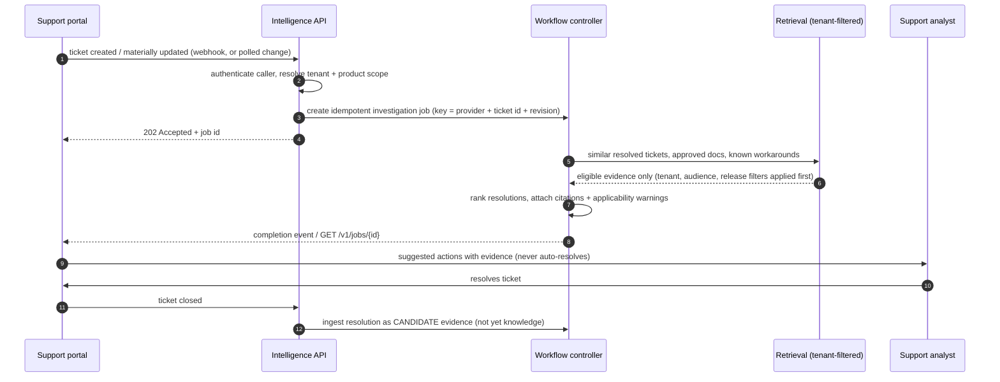

# Support portal, in-app diagnostics, identity and publishing (design only)

> **Not built.** The POCs in this repository have no support-portal connector, no SSO, no tenant model,
> no client-facing interface and no ReadMe.io connector. The web workspace binds to `127.0.0.1` and has
> no user accounts. This page summarises how the engineering narrative v1 proposes to add them, and
> what is still undecided.

## 1. Support-portal integration

Design points:

- **A live ticket is a signal; a validated resolution is potential knowledge.** Closed tickets enter
  the corpus only as candidate evidence, through the same privacy classification as any other source.
- **Ticket identity is provider + portal namespace + external ticket ID.** Closing and reopening change
  state, not identity. Comments, ledger entries and attachments each have their own provider identity.
  Open and closed tickets are *views* over one table, not two copies.
- **Internal notes are not client-visible.** The schema review flagged that comment visibility must be
  modelled so client-facing retrieval can exclude internal notes.
- **Screenshots in tickets** (about 20% of tickets in the planning estimate) can show bank details,
  names or a client's own customers, so they need visual privacy screening before they become searchable.
- **Measure outcomes, not agent completions:** suggestion acceptance, first-touch resolution, reopens,
  time to resolution. Repeatedly failed suggestions lower confidence and trigger content review.

## 2. In-application diagnostics

The application calls `POST /v1/diagnostics/analyze` with a **sanitised** error code, component,
operation, release, relevant feature flags and non-sensitive context. The service searches known errors,
runbooks, release notes and prior incidents and returns likely causes and safe diagnostic steps.
It must not need raw transaction payloads, account details or database dumps. Reading a client's actual
configuration (through a future "configuration conduit") would improve precision but is deliberately
deferred; until then answers must say plainly when client-specific configuration could not be inspected.

## 3. Identity, SSO and tenant separation: open questions

The design is firm on *where* controls live and open on *how* they are implemented.

**Five enforcement boundaries** (all in services and storage, never in prompts):

1. Source permissions: may this artifact be collected at all?
2. Storage permissions: who may read raw or restricted assets?
3. Indexing permissions: which derived content may enter which search corpus?
4. Retrieval permissions: which evidence may this user, tenant or service see?
5. Publication permissions: which audiences see an approved article?

**Decided (2026-11-03, parked decisions record):**

- Client-specific information stays private to that client.
- Issues that recur across clients may feed general knowledge, so a third client can get a useful
  general answer, without exposing any client's ticket, identity or confidential details. The
  sharing, redaction and approval mechanics are still to be designed.
- Human approval is required before publication.
- Every outbound AI payload must be auditable exactly as sent.

**Still open (narrative §19, decision register ADR-012, schema review Q1–Q8):**

| Question | Why it matters |
|---|---|
| Which identity provider (Entra ID or another) and which SSO protocol for staff and for clients? | Determines principals, group sync and service-to-service auth |
| What is a tenant: client organisation, client project, or both? How do permissions inherit? | Drives the tenant-safe composite keys and row-level security design |
| Is there ever a library shared by more than one tenant? | Yes means a separate shared tenant plus explicit sharing grants |
| Mirror Teams / Entra group membership exactly, or grant by team/channel? | Graph permission sync model |
| May redacted text and images be sent to an external LLM in production, under which contract? | Decides whether "redaction before external call" is a gate or a hard ban |
| Which PII categories, and what minimum detector recall on a labelled sample? | No redaction detector exists yet |
| Who may approve content for client-facing use; do sensitive topics need two approvers? | Approval roles; agents must never be able to approve |
| Retention, residency, RPO/RTO | Backup, object storage and key-management design |
| "Customer-support approved-safe-only retrieval gate" and "ticket/Teams permission synchronisation" | Both explicitly TBD, neither approved nor rejected |

## 4. Publishing to ReadMe.io

- **Documentation is an output of the platform, not its knowledge store.** Confluence stays a legacy
  ingestion source only.
- A **documentation planner** decides whether a gap needs a new article, a revision, an FAQ, a
  troubleshooting entry or an API reference update. A **template registry** defines six types (user
  guide, API reference, knowledge base, FAQ, conceptual, troubleshooting) with mandatory sections and
  quality checks.
- A **writer** produces an evidence-backed draft; deterministic validators and a quality reviewer check
  completeness, source support, privacy and consistency; an **authorised human approves**.
- Each package carries a **media manifest**: approved screenshots and diagrams with captions, alt text,
  source references, privacy-review state and publication locations. The design warns not to assume the
  article API accepts raw image binaries; upload, asset management and versioning must be proven in a
  connector proof of concept.
- **A documentation gap stays open until a human approves and the article is published.** Draft
  generation alone never closes it.
- **Condition on ReadMe.io (ADR-008):** a single project for internal and external audiences is
  preferred only if its access controls can actually separate them. That has not been verified.

## What exists today that this builds on

- POC 1 already produces documentation gaps with citations and keeps them `AGENT_PROPOSED` until a
  human decision.
- POC 2 already separates evidence from generated text, keeps saved answers as an audit trail ("never a
  trusted embedding corpus"), and keeps user-uploaded images chat-private and out of shared knowledge.
- The KB site scraper keeps each article's original URL, so answers already link back to the live page.
